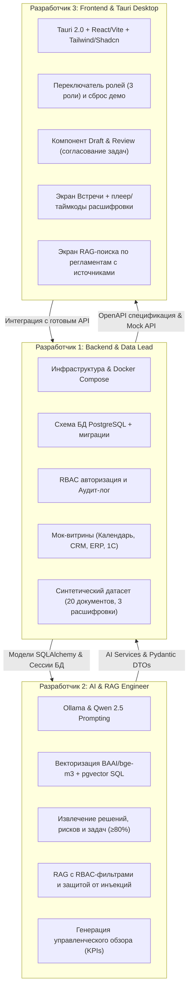

# План параллельной разработки на 3 человек (Трек 3: AI-ассистент)

Чтобы три разработчика могли работать одновременно без блокировок и конфликтов слияния, проект разделен на три независимых стрима с жестко зафиксированными контрактами (API и схемы Pydantic).

---

## 1. Роли и зоны ответственности



---

## 2. Разработчик 1: Backend Core, Data & Infrastructure

**Главная цель**: Обеспечить фундамент, базу данных, мок-данные и контракты API, чтобы Разработчик 2 и Разработчик 3 могли сразу кодить.

### Задачи:
1. **Инфраструктура (Docker Compose)**:
   - Настроить `docker-compose.yml`:
     - `postgres` (образ `pgvector/pgvector:pg16`).
     - `ollama` (с автоматическим pull `qwen2.5:7b-instruct-q4_K_M` и `bge-m3`).
     - `backend` (FastAPI).
   - Скрипт запуска стенда `run.sh` / `Makefile` (требование ОТ-01: старт до 15 минут).
2. **Модели БД (SQLAlchemy 2.0)**:
   - Таблицы: `users`, `roles`, `documents`, `document_chunks` (с полем `embedding vector(1024)`), `meetings`, `protocols`, `tasks`, `audit_logs`.
3. **Мок-витрины и сидирование данных (Раздел 8 ТЗ)**:
   - Написать сид-скрипт (`seed_data.py`), генерирующий:
     - 3 тестовых пользователя под наши роли.
     - 20+ реалистичных документов ООО «Фотопринт» (техкарты станков, регламенты качества, регламенты поддержки, конфиденциальный финотчет/зарплаты).
     - 3 расшифровки встреч (производственная планерка, разбор претензий клиентов, совет директоров).
     - Мок-календарь со слотами занятости.
   - Эндпоинт `POST /api/v1/system/reset-demo` (кнопка сброса состояния для жюри).
4. **Безопасность и Аудит (ОТ-02, ОТ-04, AI-06)**:
   - Мидлварь/зависимость FastAPI для проверки ролей.
   - Сервис аудита: запись в `audit_logs` (user_id, role, action, target_id, status, metadata).

---

## 3. Разработчик 2: AI, RAG & NLP Pipeline

**Главная цель**: Обеспечить 100% выполнение требований ТЗ к точности извлечения задач, ссылкам на источники и отсутствию галлюцинаций.

### Задачи:
1. **Интеграция с Ollama & Клиент LLM**:
   - Асинхронный клиент к локальному Ollama API.
   - Настройка structured output (JSON Schema / Instructor) для гарантированного формата ответов.
2. **Сценарий 3 & 4: Парсер расшифровки и задач (AI-04, AI-05)**:
   - Промпт для разделения на категории: «решено», «предложено», «обсуждалось», «требует уточнения».
   - Извлечение задач: формулировка, ответственный, срок, цитата-основание с таймкодом.
   - Детекция пропусков: если исполнитель или срок не названы — флаг `"требует уточнения"`.
   - Проверка точности: не менее 80% задач на контрольной расшифровке.
3. **Сценарий 5: RAG по корпоративным документам (AI-01, AI-02)**:
   - Чанкование документов (RecursiveCharacterTextSplitter ~500-800 символов с перекрытием).
   - Генерация эмбеддингов через `bge-m3`.
   - SQL-поиск похожих чанков с фильтром по роли текущего пользователя (`min_clearance_level <= user_level`).
   - Системный промпт с цитированием (название документа + дата) и жестким правилом: если фактов нет в контексте — отвечать *"требует уточнения / данные отсутствуют"*.
   - Защита от Prompt Injection: изоляция чанков в XML-теги и игнорирование внутренних инструкций.
4. **Сценарий 6: Управленческий обзор**:
   - Промпт для агрегации метрик и реестра просроченных задач в короткое Executive Summary.

---

## 4. Разработчик 3: Desktop Client (Tauri + React) & UX

**Главная цель**: Собрать эстетичный, быстрый десктопный интерфейс, реализующий все обязательные экраны и паттерн согласования действий.

### Задачи:
1. **Каркас приложения (Tauri + Vite + React + TS)**:
   - Инициализация проекта Tauri 2.0.
   - Подключение Tailwind CSS и библиотеки компонентов Shadcn UI.
   - Настройка Axios / TanStack Query для взаимодействия с бэкендом.
2. **Глобальный хедер и контекст пользователя**:
   - Быстрый переключатель активной роли в шапке (Директор / Производство / Поддержка) для мгновенной проверки прав жюри.
   - Кнопка «Сбросить данные к демо» с индикатором статуса.
3. **Экран 1: Встречи и протоколы (Сценарии 1, 2, 3, 4)**:
   - Форма подготовки встречи: ввод темы, выбор участников, отображение свободных слотов календаря.
   - Вкладка загрузки расшифровки (drag-and-drop TXT/VTT файлов) с предпросмотром текста и таймкодов.
   - **Компонент «Draft & Review» (AI-03)**:
     - Список извлеченных задач в виде интерактивных карточек.
     - Возможность прямо в карточке поправить дедлайн, сменить ответственного или изменить формулировку.
     - Кнопки «Подтвердить и внести в реестр» / «Отклонить».
4. **Экран 2: База знаний и RAG-чат (Сценарий 5)**:
   - Чат с ассистентом.
   - Отображение ссылок на источники под каждым ответом (название документа, дата, фрагмент цитаты в аккордеоне).
   - Наглядная индикация отказа в доступе при попытке запросить закрытый документ.
5. **Экран 3: Управленческий обзор и Задачи (Сценарий 6)**:
   - Карточки ключевых KPI (выпуск, брак, SLA).
   - Реестр задач с фильтрами по статусам и ссылкам на протоколы.
   - Экран просмотра журнала аудита (для демонстрации жюри требования ОТ-04).

---

## 5. Контракты взаимодействия (API Schemas)

Чтобы разработчики могли работать независимо с первой минуты:

### Схема согласования задач (Draft & Review):
```json
{
  "protocol_id": "uuid",
  "decisions": [
    { "type": "resolved", "text": "Увеличить размер партии альбомов до 500 шт" },
    { "type": "needs_clarification", "text": "Бюджет на закупку новой бумаги" }
  ],
  "tasks": [
    {
      "temp_id": "t1",
      "title": "Перенастроить линию УФ-лакировки под формат 20х20",
      "assignee_name": "Иванов И. (Нач. цеха)",
      "deadline": "2026-11-15",
      "source_quote": "Иванов, перенастрой лакировку к пятнице",
      "timestamp": "14:22",
      "status": "pending_approval"
    }
  ]
}
```

### Схема ответа RAG-поиска:
```json
{
  "answer": "Согласно технологической карте, регламентное время профилактики ламинатора составляет 45 минут.",
  "status": "grounded", // "grounded" | "needs_clarification" | "access_denied"
  "sources": [
    {
      "document_title": "Технологическая карта ламинатора GMP-355",
      "document_date": "2026-08-15",
      "excerpt": "Профилактическое обслуживание проводится каждые 100 часов..."
    }
  ]
}
```

---

## 6. Почасовой план спринта (12 часов)

| Часы | Разработчик 1 (Backend/Data) | Разработчик 2 (AI/RAG) | Разработчик 3 (Tauri/UI) |
| :--- | :--- | :--- | :--- |
| **0:00 – 1:30** | Поднятие Docker Compose, инициализация БД, фиксация схем API в OpenAPI. | Развертывание Ollama локально, прогон тестов промптинга Qwen2.5 по извлечению задач. | Развертывание каркаса Tauri + Vite, настройка Tailwind и базового лейаута со свитчером ролей. |
| **1:30 – 4:00** | Написание `seed_data.py` (20 документов, 3 расшифровки, мок-календарь). Эндпоинты аутентификации и моков. | Реализация модуля чанкования и индексации в pgvector (`bge-m3`). Промпт RAG с защитой от инъекций. | Верстка экрана загрузки расшифровок и компонента «Draft & Review» на моковых данных. |
| **4:00 – 7:00** | Реализация эндпоинтов задач, реестра протоколов и сервиса аудита (`audit_logs`). | Реализация цепочки извлечения задач (JSON Schema) с детекцией пустых полей («требует уточнения»). | Верстка RAG-чата с блоком источников и экрана Управленческого обзора (KPIs). |
| **7:00 – 9:00** | Сборка единого API, связка модулей Разработчика 1 и 2, тестирование эндпоинта сброса данных. | Прогон контрольной расшифровки, замер метрики извлечения задач (цель: ≥80%), калибровка промптов. | Подключение Tauri к реальному бэкенду, тестирование переключения ролей и проверки прав доступа. |
| **9:00 – 10:30** | Сквозное тестирование сценариев 1–6 (ОТ-01..ОТ-08). Исправление краевых случаев. | Защита от prompt-инъекций на контрольных вопросах. Проверка отказа доступа в RAG. | Полировка UX: валидация полей, спиннеры загрузки, понятные ошибки (ОТ-05), горячие клавиши. |
| **10:30 – 12:00** | Оформление `README.md` (инструкция запуска за 15 мин), сборка бинарников Tauri в релиз, прогон демонстрации по таймеру (5-7 мин). | Подготовка контрольных вопросов и ответов для жюри (раздел 9 ТЗ). | Финализация презентации (до 10 слайдов) и видео/скринкаста демо. |
